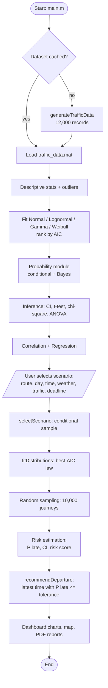
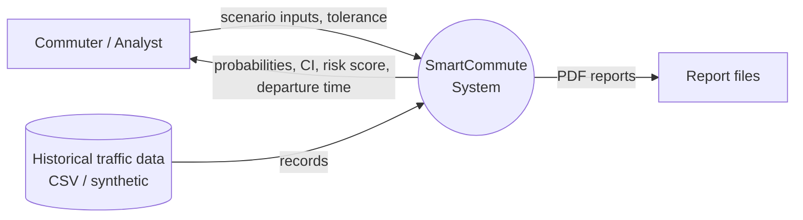
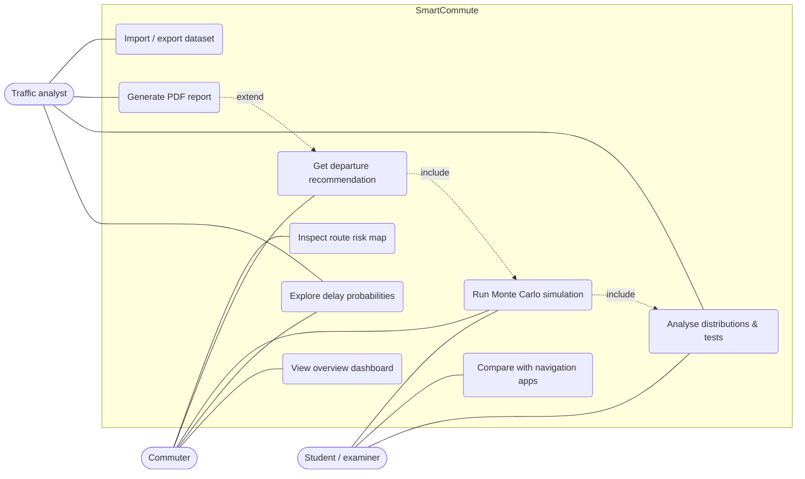
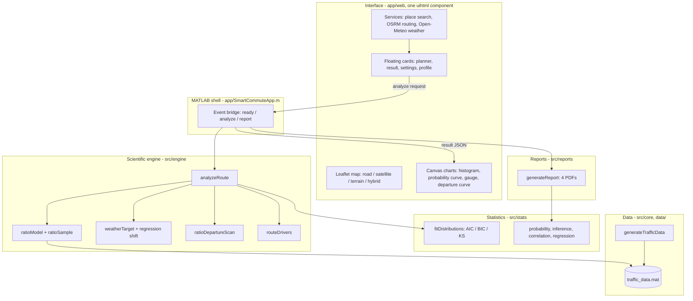
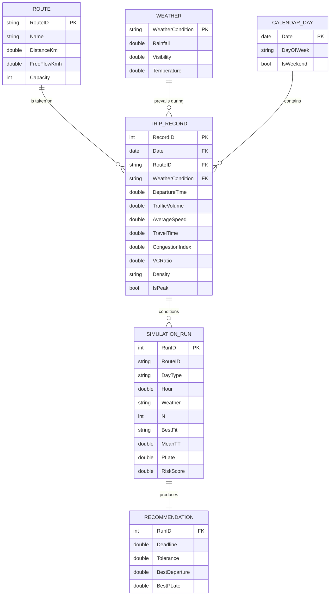

# SmartCommute - Diagrams (Mermaid)

Render in GitHub, VS Code (Markdown Preview Mermaid), https://mermaid.live, or export to PNG for the report.

## 1. System flowchart


## 2. Data-flow diagram - Level 0 (context)


## 3. Data-flow diagram - Level 1
```mermaid
flowchart LR
    U[Commuter] -->|inputs| P5
    D1[(D1 Traffic dataset)] --> P1[1.0 Data management<br/>generate / import / validate]
    P1 --> P2[2.0 Statistical analysis<br/>describe, outliers, fit, correlate, regress]
    P2 --> D2[(D2 Model store<br/>fits, tests, coefficients)]
    D1 --> P3[3.0 Probability & inference<br/>P(TT>t), conditional, CI, tests]
    P3 --> D2
    D2 --> P4[4.0 Scenario selection]
    D1 --> P4
    P4 --> P5[5.0 Monte Carlo engine<br/>sample, simulate, risk score]
    P5 --> P6[6.0 Departure recommender]
    P5 --> P7[7.0 Visualisation & map]
    P6 --> P7
    P5 --> P8[8.0 Report generator]
    P2 --> P8
    P3 --> P8
    P6 --> P8
    P7 -->|dashboard| U
    P8 -->|PDF| U
```

## 4. Use-case diagram


## 5. Architecture diagram


## 6. ER diagram

